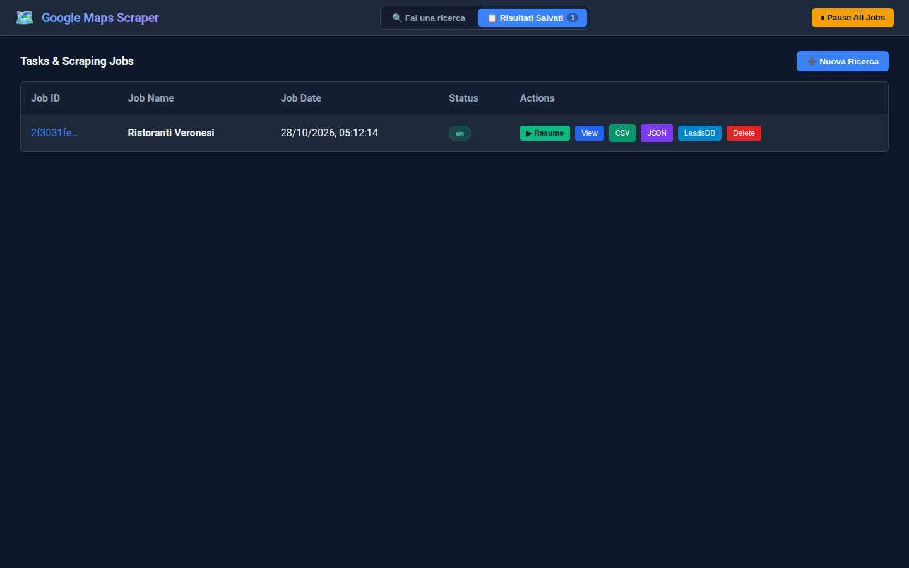
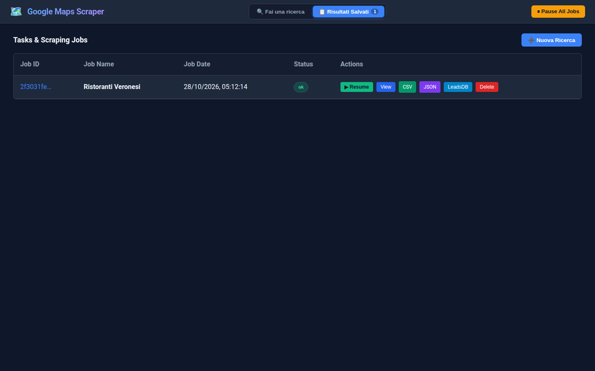
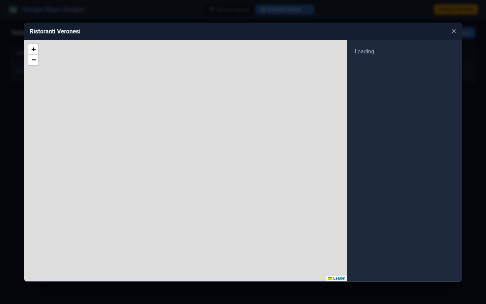

# Google Maps Scraper (Gosom Web UI)

Una Web UI moderna, performante e completa per orchestrare e gestire il motore di scraping [gosom/google-maps-scraper](https://github.com/gosom/google-maps-scraper).

Consente di raccogliere lead, dettagli aziendali, contatti (email, numeri di telefono, social), recensioni e coordinate geografiche direttamente da Google Maps, con supporto completo a modalità griglia geografica, controllo intelligente dei job e visualizzazione interattiva senza lag.

---

## 📸 Anteprima Interfaccia

### 1. Nuova Ricerca & Mappa Griglia Interattiva
Modalità Pro attiva di default con tutte le opzioni avanzate espanse, stima dinamica della superficie coperta in $km^2$ in base allo Zoom e visualizzazione del reticolo delle celle della Bounding Box.


### 2. Risultati e Monitoraggio Job
Tabella con stato in tempo reale, pulsanti di controllo (**Resume / Pause sul medesimo Job ID senza duplicati**) ed esportazione diretta.


### 3. Modale Mappa Interattiva (Zero Lag con Clustering)
Visualizzazione fluida a 60fps con rendering accelerato su Canvas (`Leaflet.markercluster` + GPU Canvas) capace di gestire oltre 5.000–10.000 punti senza freeze del browser.


---

## ✨ Funzionalità Principali

- ⚡ **Pro Mode di Default**: Tutti i parametri avanzati (concurrency, depth, email, proxies, filtri, DSN, S3, Lambda) subito a portata di mano, con possibilità di passare alla vista compatta (Nome + Keywords) con un clic.
- 📐 **Zoom Area Estimator**: Stima dinamica in tempo reale della superficie coperta in $km^2$ (da quartiere a intera nazione) per scegliere il livello ottimale di dettaglio.
- 🗺️ **Grid Bounding Box & Cell Selector**:
  - Controllo manuale puntuale sui **4 vertici del perimetro** (Min Lat, Min Lon, Max Lat, Max Lon).
  - Personalizzazione libera del numero di celle (Righe × Colonne) con calcolo automatico del passo in km.
  - Mappa Leaflet integrata per verificare graficamente il reticolo prima dell'avvio.
- ⏯️ **Gestione Job Singolo (Zero Duplicati)**:
  - Il pulsante **Pause** interrompe il container runner preservando i risultati su disco.
  - Il pulsante **Resume** riprende l'estrazione sullo stesso Job ID e sullo stesso file CSV, deduplicando le attività già salvate senza creare righe orfane.
- 🚀 **Rendering Mappa Ottimizzato**:
  - Clustering intelligente e disegno su Canvas hardware per eliminare qualsiasi lag anche su set di dati enormi.
  - Paginazione protetta della tabella (primi 200 elementi) per non appesantire la memoria del browser.
- 📥 **Esportazione Multi-formato**:
  - Download diretto in formato **CSV** e **JSON strutturato**.
  - Integrazione con **LeadsDB** per l'invio batch delle anagrafiche estratte.

---

## 🚀 Avvio Rapido (Docker Compose)

Il modo più rapido per avviare l'intero stack (backend gosom + web UI Flask) è tramite Docker Compose:

```bash
docker compose up -d --build
```

L'interfaccia web sarà subito accessibile all'indirizzo:
👉 **`http://localhost:8080`**

Per arrestare i servizi:
```bash
docker compose down
```

---

## ⚙️ Architettura del Progetto

```text
├── app.py                 # Applicazione Flask + Web UI reattiva integrata
├── Dockerfile             # Definizione container UI
├── docker-compose.yml     # Orchestrazione backend gosom (8081) e web UI (8080)
├── data/                  # Volume contenente database SQLite, file CSV e resume state
├── docs/screenshots/      # Screenshot dell'interfaccia per la documentazione
└── bin/gmaps              # Script CLI per avvio/arresto rapido da terminale
```

## 🔒 Sicurezza
Nessuna chiave API o credenziale privata è presente nel repository. Tutte le configurazioni personali vengono salvate unicamente nel `localStorage` del browser dell'utente.

---

## Licenza
MIT
